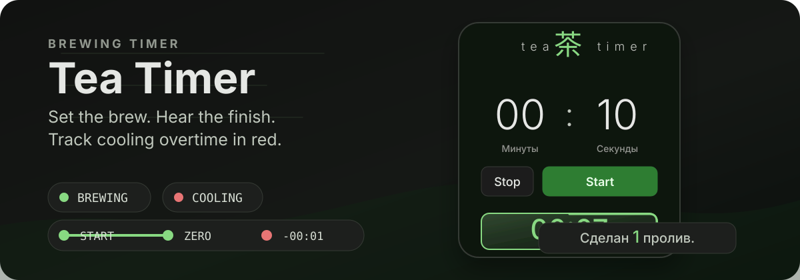

# Чайный таймер

<p align="center">
  
</p>

<p align="center">
  <strong>Небольшой таймер для вдумчивого чаепития.</strong><br>
  Выберите время, заварите чай и не дайте ему остыть.
</p>

<p align="center">
  <a href="https://my-tea-timer.vercel.app/"><strong>Открыть таймер</strong></a>
  &nbsp;·&nbsp;
  <a href="https://github.com/hardd23/tea-timer/releases/latest"><strong>Скачать для Android</strong></a>
</p>

<p align="center">
  <a href="https://my-tea-timer.vercel.app/"></a>
  <a href="https://github.com/hardd23/tea-timer/releases/latest"></a>
  <a href="./LICENSE"></a>
</p>

## Что умеет

| | Возможность |
| --- | --- |
| ⏳ | Горизонтальная карусель времени — от 10 секунд до 55 минут с удобным шагом. `0″` показан отдельно и недоступен для запуска. |
| 🍵 | Две фазы таймера: заваривание до нуля и отсчёт остывания после него. |
| 🔢 | Счётчик проливов с автоматическим учётом и ручной корректировкой кнопками `−` / `+` — до 99. |
| 🌗 | Светлая и тёмная темы, которые запоминаются на устройстве. |
| RU / EN | Русский и английский интерфейс без перезагрузки страницы. |
| 💬 | 315 чайных высказываний в случайном порядке. |

## Как это работает

1. Выберите время на карусели и нажмите «Старт».
2. Во время заваривания граница таймера показывает ход отсчёта.
3. Когда время выйдет, таймер автоматически перейдёт в режим остывания, а счётчик добавит пролив.
4. Нажмите красную кнопку сброса, чтобы начать новое чаепитие.

Таймер использует точное время окончания, поэтому восстанавливает корректный результат после сворачивания вкладки или блокировки экрана.

## Открыть или установить

### Веб-версия

Откройте [my-tea-timer.vercel.app](https://my-tea-timer.vercel.app/) в современном браузере на телефоне или компьютере.

### Android

Скачайте актуальный файл `Tea-Timer-*.apk` со страницы [Releases](https://github.com/hardd23/tea-timer/releases/latest), откройте его на Android-устройстве и подтвердите установку. APK подписан постоянным ключом приложения, поэтому следующие версии можно устанавливать поверх предыдущих.

> Android может попросить разрешить установку приложений из этого источника — это стандартное системное сообщение для APK, скачанных не из Google Play.

## Локальный запуск

Нужны Node.js 20+ и npm.

```bash
npm ci
npm run dev
```

После запуска откройте [http://localhost:3000](http://localhost:3000).

| Команда | Назначение |
| --- | --- |
| `npm run dev` | Запустить режим разработки. |
| `npm run lint` | Проверить код ESLint. |
| `npm run build` | Собрать статическую production-версию в `out/`. |
| `npm start` | Запустить production-сервер Next.js. |

## Стек

- [Next.js](https://nextjs.org/) 16 · статический экспорт
- [React](https://react.dev/) 19 · [TypeScript](https://www.typescriptlang.org/)
- [Tailwind CSS](https://tailwindcss.com/) 4
- [Capacitor](https://capacitorjs.com/) 8 · Android
- [Vercel](https://vercel.com/) · веб-публикация

## Структура проекта

```text
app/
  components/          # Таймер, карусель, темы, языки и диалоги
  data/                # Коллекция чайных высказываний
  globals.css          # Общая визуальная система
assets/readme/         # Иллюстрация для этой страницы
public/notification.mp3 # Звук завершения заваривания
```

## Ссылки

- [Веб-версия](https://my-tea-timer.vercel.app/)
- [Android-релизы](https://github.com/hardd23/tea-timer/releases)
- [Telegram @hardd23](https://t.me/hardd23)
- [GitHub-репозиторий](https://github.com/hardd23/tea-timer)
- [Угостить автора чаем](https://web.tribute.tg/d/OyG)

## Лицензия

Исходный код распространяется по [лицензии MIT](./LICENSE). Атрибуция визуальных материалов и чайных высказываний указана в [NOTICE.md](./NOTICE.md).
