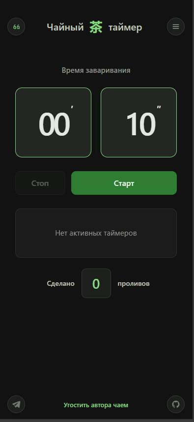
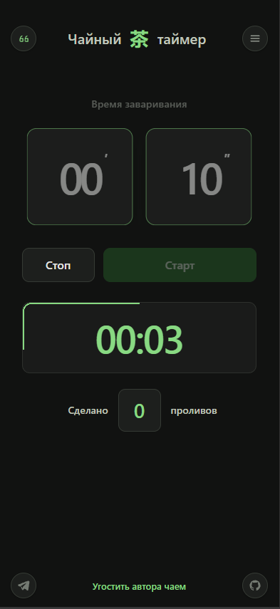
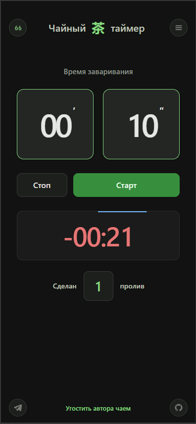
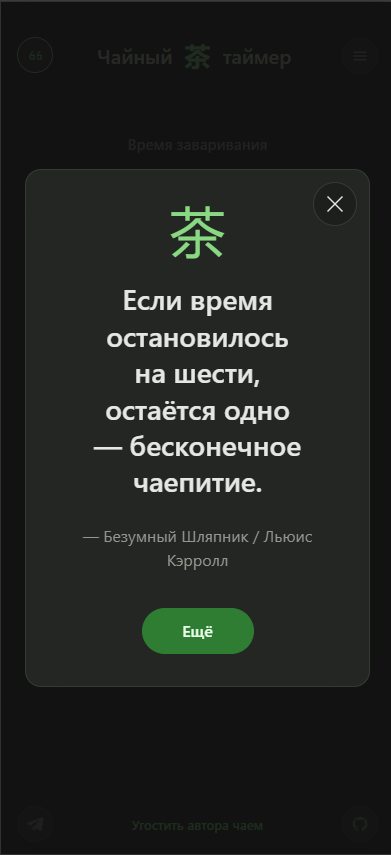
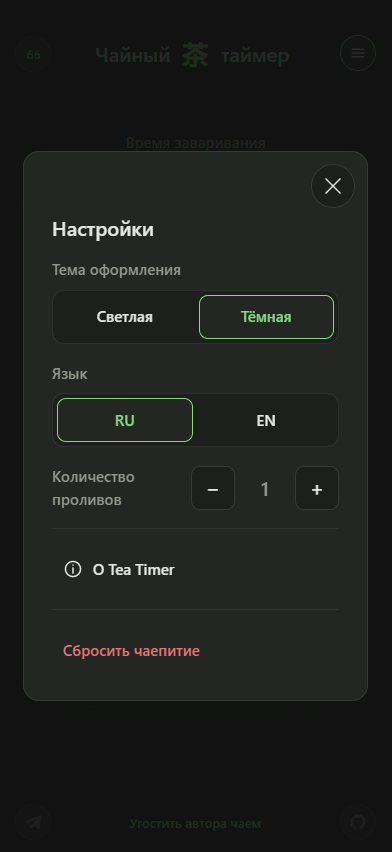

<h1 align="center">Tea Timer · Tea Brewing Timer</h1>

  <strong>A small timer for mindful tea drinking.</strong> 
  Choose a time, brew your tea, and do not let it get cold.

  <a href="https://hardd23.github.io/tea-timer/"><strong>App Website</strong></a>
  &nbsp;·&nbsp;
  <a href="https://my-tea-timer.vercel.app/"><strong>Open Timer</strong></a>
  &nbsp;·&nbsp;
  <a href="https://github.com/hardd23/tea-timer/releases/latest"><strong>Download for Android</strong></a>

  
  
  
  
  

## Tea Timer Interface

  
  &nbsp;
  
  &nbsp;
  

  Time selection · Brewing · Cooling after zero

  
<strong>More screens: tea sayings and settings</strong>

   
  

    
    &nbsp;
    
  

## Features

| | Feature |
| --- | --- |
| ⏳ | Independent vertical minute and second wheels with precise gesture, mouse wheel, or keyboard control. |
| 🍵 | Two timer phases: brewing until zero and cooling time after it. |
| 🔢 | Infusion counter with automatic tracking and manual adjustment in settings — up to 99. |
| 🌗 | Light and dark themes that are remembered on the device. |
| RU / EN | Russian and English interfaces without reloading the page. |
| 💬 | 315 tea sayings in random order. |
| ↻ | Android app update checks through GitHub Releases. |

## What Is New in 1.1.1

- A unified settings menu for the theme, language, infusion counter, app information, and resetting the tea session.
- New vertical time selection wheels with calmer and more precise scrolling.
- Android app update checks and navigation to the new release page.
- Improved interface responsiveness and typography.
- Fixed an unnecessary focus outline and independent seconds transition between `50` and `00`.

## How It Works

1. Select minutes and seconds on the vertical wheels and press “Start.”
2. During brewing, the timer border shows the countdown progress.
3. When time runs out, the timer automatically switches to cooling mode, and the counter adds an infusion.
4. Open settings and select “Reset tea session” to start over.

The timer uses the exact end time, so it restores the correct result after the tab is minimized or the screen is locked.

## Open or Install

### App Website

[**Tea Timer on GitHub Pages**](https://hardd23.github.io/tea-timer/) — the project landing page with a feature overview, interface images, installation instructions, and links to the latest Android release and web version.

### Web Version

Open [my-tea-timer.vercel.app](https://my-tea-timer.vercel.app/) in a modern browser on your phone or computer.

### Android

Download the latest `Tea-Timer-*.apk` file from the [Releases](https://github.com/hardd23/tea-timer/releases/latest) page, open it on your Android device, and confirm the installation. The APK is signed with the app's permanent key, so future versions can be installed over previous ones.

> Android may ask you to allow app installation from this source — this is a standard system message for APK files downloaded outside Google Play.

## Tech Stack

- [Next.js](https://nextjs.org/) 16 · static export
- [React](https://react.dev/) 19 · [TypeScript](https://www.typescriptlang.org/)
- [Tailwind CSS](https://tailwindcss.com/) 4
- [Capacitor](https://capacitorjs.com/) 8 · Android
- [Vercel](https://vercel.com/) · web deployment
- [GitHub Pages](https://pages.github.com/) · project landing page

## Links

- [Tea Timer landing page](https://hardd23.github.io/tea-timer/)
- [Web version](https://my-tea-timer.vercel.app/)
- [Android releases](https://github.com/hardd23/tea-timer/releases)
- [Telegram @hardd23](https://t.me/hardd23)
- [GitHub repository](https://github.com/hardd23/tea-timer)
- [Buy the author tea](https://web.tribute.tg/d/OyG)

## License

The source code is distributed under the [MIT License](./LICENSE). Attribution for visual materials and tea sayings is provided in [NOTICE.md](./NOTICE.md).
